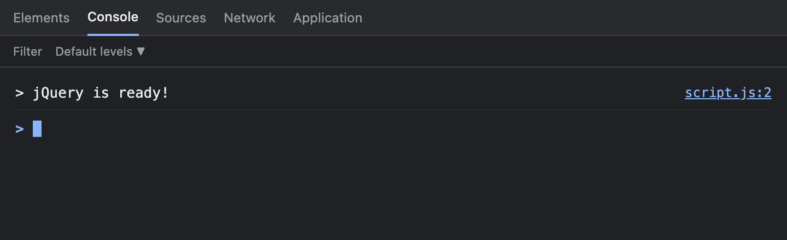
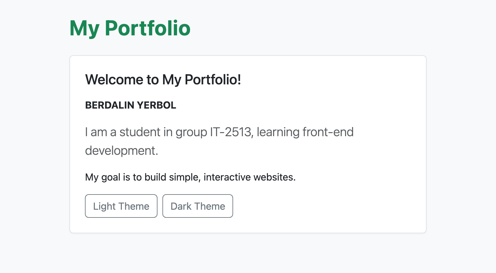
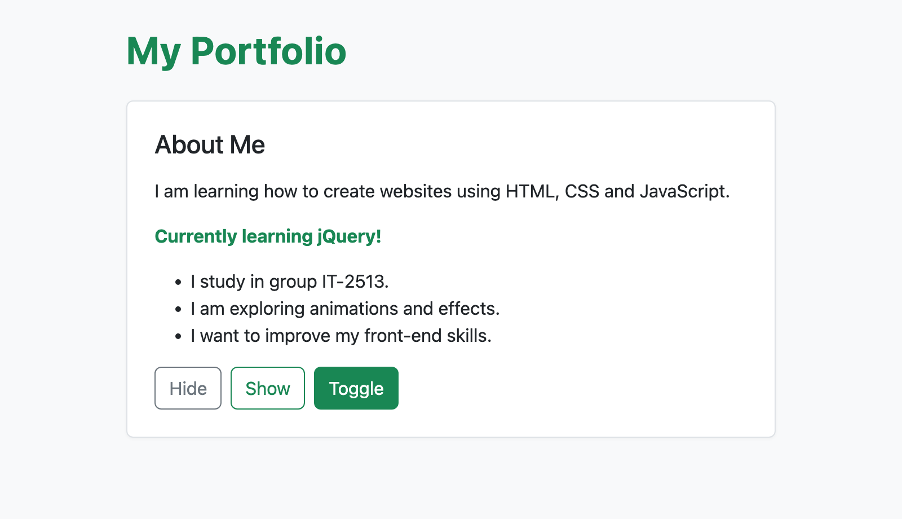
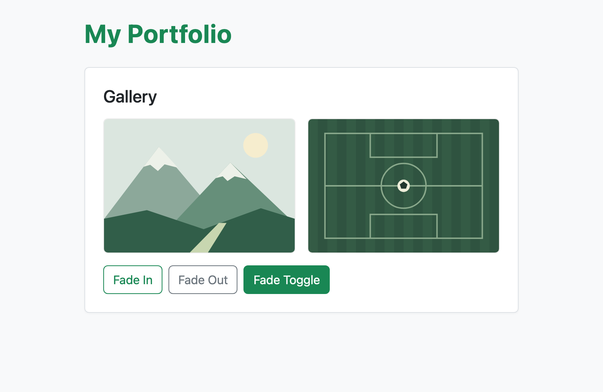
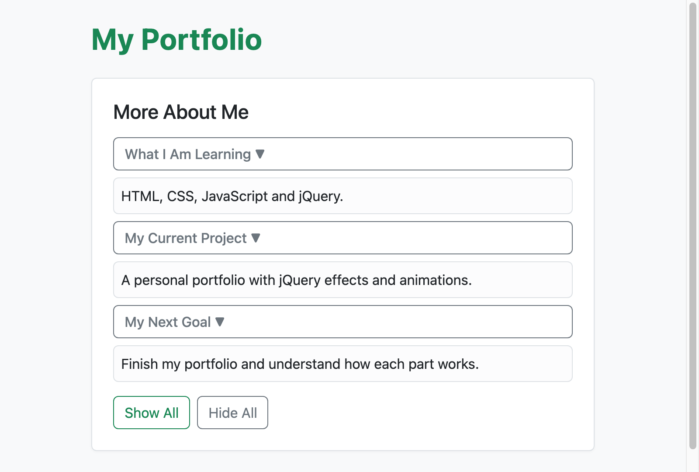
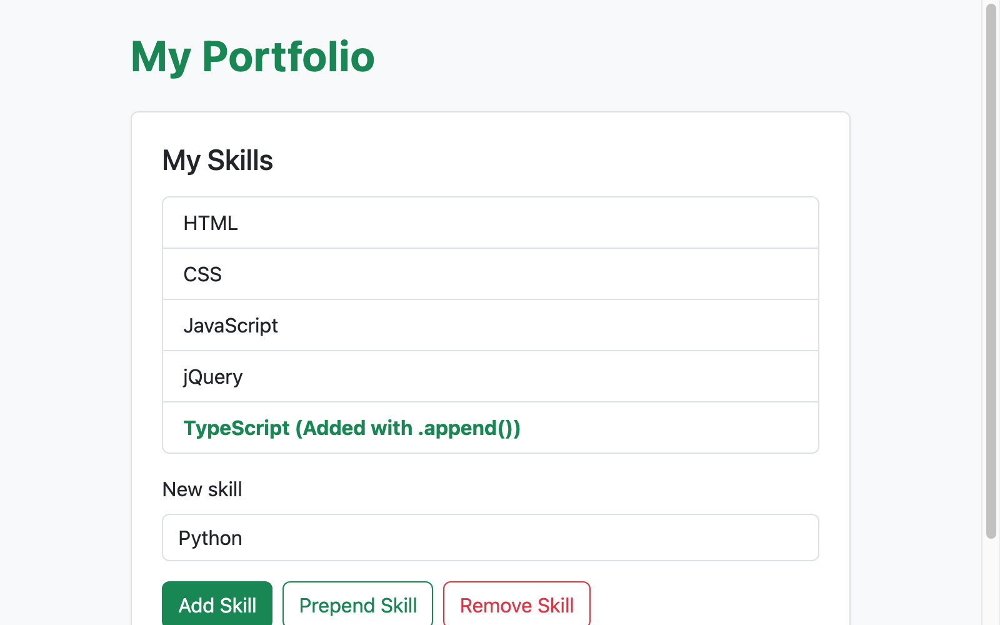
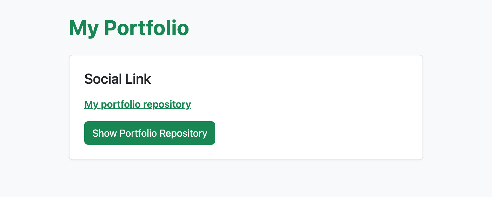
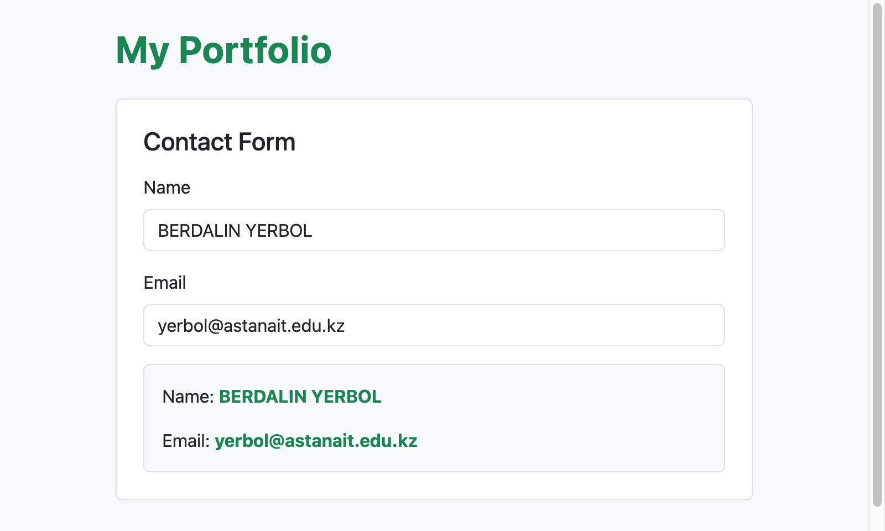
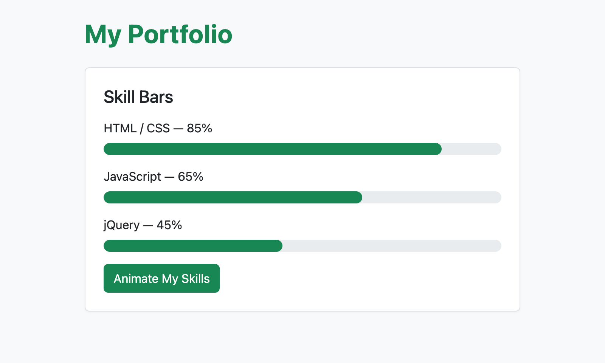

# Assignment 6 — jQuery Portfolio

Name: BERDALIN YERBOL  
Group: IT-2513  
Repository: https://github.com/yerbolberdalin1/web-1---6assignment  
GitHub Pages: https://yerbolberdalin1.github.io/web-1---6assignment/

## Part 1. Getting Started with jQuery

### Task 0. Setup
I included the jQuery library via CDN in the head section of the HTML page. Inside $(document).ready(), I added a console.log statement that outputs "jQuery is ready!" to confirm the library is loaded properly.

### Task 1. Selectors & CSS
I created a profile section with my name, group IT-2513, and a short intro. Using jQuery tag, ID, and class selectors, I changed the greeting text and updated styles. I also added Light Theme and Dark Theme buttons that switch themes using Bootstrap data-bs-theme.

## Part 2. jQuery Effects

### Task 2. Visibility Methods
In the About Me section, I wrote a short bio, current status ("Currently learning jQuery!"), and three fun facts about my interests. I added three buttons (Hide, Show, Toggle) that use jQuery hide(), show(), and toggle() methods to show or hide the information.

### Task 3. Fade Methods
I created a gallery section with two illustration images (mountains and football). Below the images, I added buttons that use fadeIn(), fadeOut(), and fadeToggle() to smoothly control the transparency and visibility of the pictures.

### Task 4. Slide Methods
I added three collapsible panels with information about what I am learning, my current project, and my next goal. Clicking any heading smoothly slides the panel open or closed using slideToggle(). I also added Show All and Hide All buttons that use slideDown() and slideUp().

## Part 3. DOM Manipulation with jQuery

### Task 5. Add & Remove Elements
The skills section displays four initial skills: HTML, CSS, JavaScript, and jQuery. Visitors can type a new skill into the input field. Three buttons allow adding to the end (append), adding to the beginning (prepend), or deleting the last item (remove). Empty input is ignored using trim().

### Task 6. Modifying Attributes
I added a link to my GitHub profile. Clicking the button uses the jQuery attr() method to change the link destination to my assignment repository and update the link text.

### Task 7. Form Interaction
I created a contact form with Name and Email inputs. When the user types in either input, the jQuery input event reads the values with val() and displays them live in the preview box below using text().

## Part 4. Animations

### Task 8. Basic Animation
I created three skill progress bars for HTML/CSS (85%), JavaScript (65%), and jQuery (45%). All bars start with 0% width. When the "Animate My Skills" button is clicked, jQuery animate() smoothly increases their width to the target levels. Clicking the button again animates them back to 0%.

## Work Process
I created the HTML markup using Bootstrap for the layout and wrote custom styles in style.css for additional polish. Then I connected jQuery via CDN and wrote the event handlers in script.js to implement all required effects, DOM manipulations, live form typing, and progress bar animations. Finally, I tested each feature in Google Chrome, captured screenshots for the report, and published the project to GitHub Pages.
